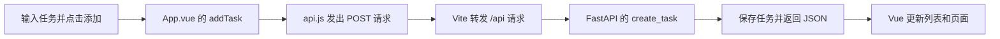

# 我的第一个前后端项目：学习任务清单

目标：用一个可以运行的小项目，理解 Vue 3 页面、FastAPI 接口，以及它们如何交换数据。

你可以添加学习任务、查看列表、勾选完成、删除任务。代码中有中文注释，适合学过一点 Java、正在重新入门的同学。

**先知道一个约定：任务保存在后端内存里。刷新浏览器不会丢失任务，重启后端会恢复三条示例任务。修改后端代码触发自动重启时，也会重置。**

## 1. 先跑起来

首次克隆后，请先完成后面的“首次安装”，再启动前后端。

在项目目录打开两个 PowerShell 终端，分别运行前后端。它们需要同时运行。

**终端一：启动后端**

```powershell
.\backend\.venv\Scripts\python.exe -m uvicorn main:app --app-dir backend --reload --host 127.0.0.1 --port 8000
```

- `python.exe`：使用这个项目的 Python 虚拟环境。
- `uvicorn`：运行 FastAPI 的 Web 服务器。
- `main:app`：找到 `main.py` 里的 `app` 对象。
- `--app-dir backend`：告诉它去 `backend` 目录找文件。
- `--reload`：修改后端代码后自动重启，适合本地学习。
- `8000`：后端监听的端口。

**终端二：启动前端**

```powershell
cd frontend
npm run dev
```

`npm run dev` 会执行 `package.json` 中名为 `dev` 的命令，这里就是启动 Vite。

然后打开：

- [任务清单页面](http://127.0.0.1:5173)
- [后端交互式接口文档](http://127.0.0.1:8000/docs)
- [直接查看后端返回的 JSON](http://127.0.0.1:8000/api/tasks)

停止服务时，在对应终端按 `Ctrl+C`。

### 首次安装（复制项目到新电脑时）

使用 Python 3.10+ 和满足当前 Vite 版本要求的 Node.js。本项目在 Python 3.14.2、Node.js 24.21.0 上验证。

在项目根目录运行：

```powershell
python -m venv backend\.venv
.\backend\.venv\Scripts\python.exe -m pip install -r backend\requirements.txt
cd frontend
npm ci
```

这里直接使用虚拟环境中的 Python，不需要执行激活脚本。`npm ci` 按 `package-lock.json` 安装已经锁定的前端依赖。

## 2. 项目目录怎么看

```text
教我学习/
├── backend/                 后端：接收请求，处理数据
│   ├── main.py              数据模型、示例数据、四个接口
│   ├── requirements.txt     Python 依赖清单
│   └── .venv/               Python 虚拟环境，安装时生成，不用读
├── frontend/                前端：显示页面，响应用户操作
│   ├── src/
│   │   ├── main.js          Vue 应用入口
│   │   ├── App.vue          页面数据、操作逻辑、HTML 模板
│   │   ├── api.js           向后端发送 HTTP 请求
│   │   └── style.css        页面样式
│   ├── index.html           浏览器最先加载的 HTML
│   ├── vite.config.js       开发服务器和接口转发配置
│   ├── package.json         前端依赖和运行命令
│   └── package-lock.json    锁定前端依赖版本，安装时生成
├── README.md                启动说明和项目地图
├── LEARNING.md              从基础开始的阅读顺序和小练习
└── .gitignore               告诉 Git 哪些生成文件不需要保存
```

`node_modules` 是前端安装的第三方依赖，`dist` 是构建生成的文件。这两个目录和 `.venv` 一样，入门时不用阅读。

## 3. 这几个技术分别做什么

| 技术 | 在本项目中的作用 | 先理解什么 |
| --- | --- | --- |
| HTML | 描述标题、输入框、按钮、列表 | 页面有什么 |
| CSS | 设置颜色、间距、布局 | 页面长什么样 |
| JavaScript | 处理点击和请求 | 页面怎么动起来 |
| Vue 3 | 把数据和页面关联起来 | 数据变了，页面自动更新 |
| Vite | 启动前端开发服务器、处理 `.vue` 文件、构建前端 | 为什么要运行 `npm run dev` |
| Node.js / npm | 运行前端开发工具、安装依赖 | 工具运行在电脑上；页面里的 JS 运行在浏览器里 |
| Python | 编写后端业务逻辑 | 列表、函数、类、类型标注 |
| FastAPI | 把请求交给对应的 Python 函数 | HTTP 方法、接口路径、请求和响应 |
| Pydantic | 定义数据格式并检查输入 | `title` 必须是字符串，长度必须符合要求 |
| Uvicorn | 启动服务，监听后端端口 | FastAPI 需要服务器才能接收请求 |
| HTTP / JSON | 前后端通信的协议和数据格式 | 请求发出去，数据传回来 |

先把这条链路读懂：



## 4. 四个接口

| HTTP 方法 | 路径 | 用途 | 请求内容 |
| --- | --- | --- | --- |
| GET | `/api/tasks` | 查看全部任务 | 无 |
| POST | `/api/tasks` | 添加任务 | `{"title": "学习 Vue"}` |
| PATCH | `/api/tasks/1` | 修改编号 1 的完成状态 | `{"completed": true}` |
| DELETE | `/api/tasks/1` | 删除编号 1 的任务 | 无 |

这四类操作常被称为 CRUD：创建、读取、更新、删除。

返回的一个任务长这样：

```json
{
  "id": 4,
  "title": "学习 Vue",
  "completed": false
}
```

## 5. 常见问题

**页面提示请求失败**：确认后端也在运行。直接打开 `http://127.0.0.1:8000/api/tasks`，应该能看到 JSON。

**提示端口被占用**：通常已经开着一个服务。先查看已有终端，避免重复启动。前端固定使用 5173，后端固定使用 8000。

**为什么两个端口也能通信**：前端请求的是自身地址下的 `/api/...`，Vite 在服务器端把它转发给 8000 端口。看 `vite.config.js` 的 `proxy`。以后如果浏览器直接请求不同来源的后端地址，需要了解 CORS（跨域）。

**为什么重启后任务没了**：当前只有 Python 列表，没有数据库。这是教学版本的存储方式。

**`npm run build` 做什么**：把前端代码编译成 `frontend/dist` 中的静态文件。本项目先学习 `npm run dev` 下的开发流程；正式部署还需要安排静态文件托管和 API 转发。

## 6. 接下来怎么学

打开 [LEARNING.md](LEARNING.md)，按顺序读几个核心文件，再亲手完成小练习。

本项目采用 Vue 3 的 `<script setup>` 写法。后续查阅资料时，优先看官方教程：[Vue 入门](https://cn.vuejs.org/guide/quick-start.html)、[FastAPI 第一步](https://fastapi.tiangolo.com/zh/tutorial/first-steps/)、[Vite 指南](https://cn.vite.dev/guide/)。
